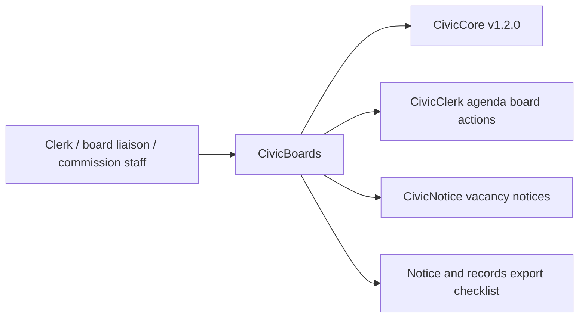

# CivicBoards User Manual

## For Non-Technical Users

CivicBoards helps city staff keep board and commission rosters, member terms, vacancy workflows, attendance review notes, meeting records, public notice context, staff review queues, and export manifests organized. It can create a sample board registry stub, build term reminders, assemble vacancy checklists, summarize attendance review, queue board review work, and assemble a notice/records export checklist.

Current state: `0.1.1` local-first board administration and staff review runtime. CivicBoards saves board roster, attendance review, and staff review queue records in a default local SQLite database. CivicBoards does not appoint members, remove members, publish official notices, provide legal advice, call live LLMs, write back to meeting systems, or update a board system of record. Staff own every decision.

## For IT and Technical Staff

CivicBoards is a FastAPI Python package pinned to the published `civiccore v1.2.0` release wheel. The current runtime exposes:

- `GET /`
- `GET /health`
- `GET /ready`
- `GET /api/v1/civicboards/readiness`
- `GET /civicboards`
- `GET /civicboards/staff`
- `GET /api/v1/civicboards/integration-contracts`
- `POST /api/v1/civicboards/registry`
- `GET /api/v1/civicboards/registry/{board_id}`
- `POST /api/v1/civicboards/terms`
- `POST /api/v1/civicboards/vacancies`
- `POST /api/v1/civicboards/attendance`
- `GET /api/v1/civicboards/attendance/{attendance_id}`
- `POST /api/v1/civicboards/export`
- `GET /api/v1/civicboards/staff/reviews`

Run:

```bash
python -m pip install -e ".[dev]"
python -m pytest -q
bash scripts/verify-release.sh
```

CivicBoards uses `CIVICBOARDS_DATA_DIR` for its default local SQLite-backed roster database, or `CIVICBOARDS_ROSTER_DB_URL` when IT needs an explicit SQLAlchemy database URL. Staff queue routes also require `CIVICBOARDS_STAFF_API_KEY`, `X-CivicBoards-Role: staff`, and `X-CivicBoards-Staff-Key` matching the configured key.

## Architecture



CivicBoards depends on CivicCore. CivicCore does not depend on CivicBoards. CivicBoards v0.1.1 uses local-first staff-gated persistence, board roster records, attendance review records, staff review queues, vacancy notice checklists, and records export checklists. Live agenda systems, appointment decisions, legal advice, official notice publication, meeting system write-back, and production board-system integrations are future work.
