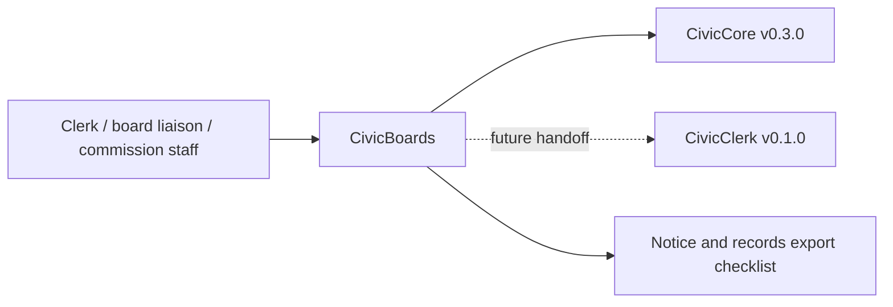

<a id="civicboards-user-manual"></a>

# Townlight Boards User Manual

## For Non-Technical Users

Townlight Boards helps city staff keep board and commission rosters, member terms, vacancy workflows, attendance review notes, meeting records, public notice context, and export manifests organized. It can create a sample board registry stub, build term reminders, assemble vacancy checklists, summarize attendance review, and assemble a notice/records export checklist.

Current state: `0.1.1` board administration foundation plus roster persistence release. Townlight Boards can optionally save board roster and attendance review records when IT configures `CIVICBOARDS_ROSTER_DB_URL`. Townlight Boards does not appoint members, remove members, publish official notices, provide legal advice, call live LLMs, write back to meeting systems, or update a board system of record. Staff own every decision.

## For IT and Technical Staff

Townlight Boards is a FastAPI Python package pinned to `civiccore==0.3.0`. The current runtime exposes:

- `GET /`
- `GET /health`
- `GET /civicboards`
- `POST /api/v1/civicboards/registry`
- `GET /api/v1/civicboards/registry/{board_id}`
- `POST /api/v1/civicboards/terms`
- `POST /api/v1/civicboards/vacancies`
- `POST /api/v1/civicboards/attendance`
- `GET /api/v1/civicboards/attendance/{attendance_id}`
- `POST /api/v1/civicboards/export`

Run:

```bash
python -m pip install -e ".[dev]"
python -m pytest -q
bash scripts/verify-release.sh
```

Set `CIVICBOARDS_ROSTER_DB_URL` to enable local SQLAlchemy-backed board roster and attendance review records. If the variable is not set, Townlight Boards keeps deterministic stateless behavior and retrieval endpoints return actionable configuration guidance.

## Architecture



Townlight Boards depends on Townlight Core. Townlight Core does not depend on Townlight Boards. Townlight Boards v0.1.1 uses deterministic sample board and commission data plus optional local roster persistence; live agenda systems, appointment decisions, legal advice, official notice publication, meeting system write-back, and production board-system integrations are future work.
